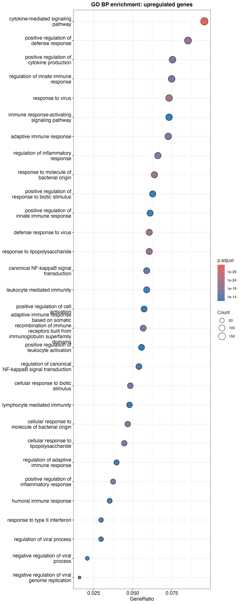
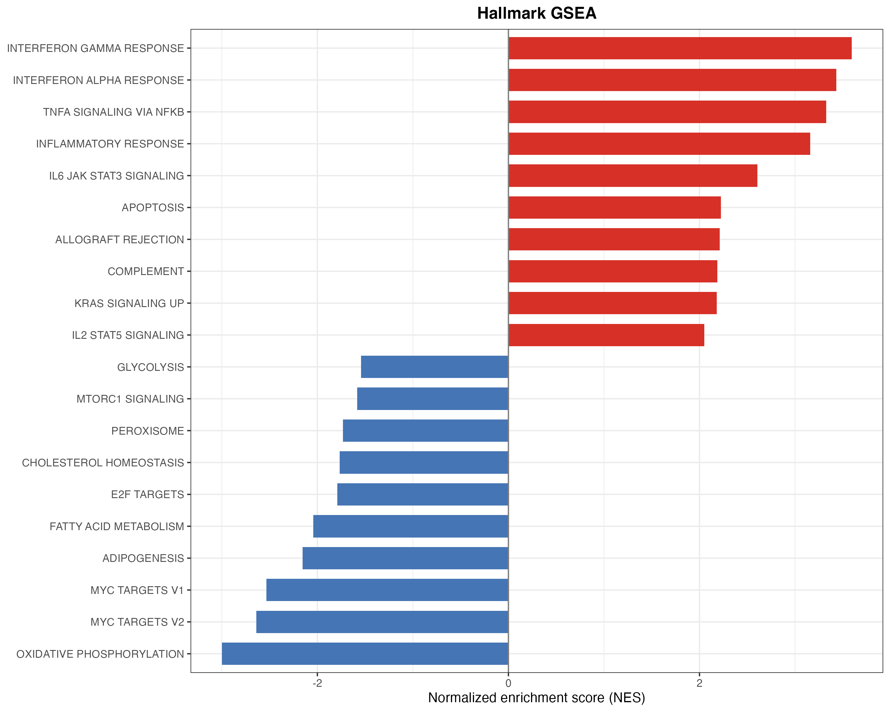

# LPS 诱导人源巨噬细胞炎症相关转录应答

**GSE163165｜配对 bulk RNA-seq 重分析｜DESeq2 · GO/KEGG · Hallmark GSEA**

本项目从公开基因计数数据出发，分析 LPS 处理后人 CD14⁺ 单核细胞来源巨噬细胞的表达变化。以炎症相关转录应答为主线，结合差异表达、分方向功能富集和供者内配对表达，解释处理后的主要生物学特征。

**主要结论：**在当前分析设置下，LPS 处理伴随炎症、细胞因子及干扰素应答相关表达增强，同时伴随氧化磷酸化、核糖体生成和翻译相关表达程序下降。

完整分析与讨论见 [分析报告](analysis_report_1.Rmd)，实现过程见 [分析脚本](scripts/macrophage_rnaseq.R)。本版本从作者提供的未归一化计数开始，覆盖下游表达分析；FASTQ 质控、比对和重新定量列为后续工作。

## 目录

- [研究问题](#研究问题)
- [数据来源与实验设计](#数据来源与实验设计)
- [分析方法](#分析方法)
- [主要结果](#主要结果)
- [结果图预览](#结果图预览)
- [项目文件](#项目文件)
- [运行与复现](#运行与复现)
- [结果解释与局限](#结果解释与局限)
- [后续工作](#后续工作)
- [参考资料](#参考资料)

## 研究问题

1. LPS 处理后，巨噬细胞是否呈现炎症相关转录应答？
2. 哪些细胞因子、趋化因子及干扰素应答基因贡献了主要富集信号？
3. 代表性炎症基因的变化在不同供者内是否具有一致方向？
4. 炎症应答是否伴随代谢及翻译相关表达程序的变化？

## 数据来源与实验设计

| 项目 | 说明 |
|---|---|
| GEO 数据集 | [GSE163165](https://www.ncbi.nlm.nih.gov/geo/query/acc.cgi?acc=GSE163165) |
| 物种 | Homo sapiens |
| 细胞 | CD14⁺ 单核细胞来源巨噬细胞 |
| 生物学重复 | 3 名女性供者，每名供者包含 Control 和 LPS 样本 |
| 分组 | Control、LPS，共 6 个样本、3 对配对重复 |
| 培养与处理 | M-CSF 5 ng/mL 培养 7 天；LPS 100 ng/mL |
| 输入数据 | `GSE163165_RAW.tar` 中的基因层面未归一化计数 |
| 分析起点 | 已完成上游定量的计数文件 |
| 比较方向 | **LPS vs Control** |
| 配对模型 | `~ donor + sampletype` |

关联原论文为 Vishnyakova 等的 *The response of two polar monocyte subsets to inflammation*（2021）。本项目仅重分析该 GEO 系列中的巨噬细胞转录组，未重新分析原论文中的其他实验。

### 样本对应关系

| GEO 样本 | 计数文件 | 项目样本名 | donor | 分组 |
|---|---|---|---|---|
| GSM4973752 | `GSM4973752_1K_merged_gene_counts.txt.gz` | Control_1 | D1 | Control |
| GSM4973753 | `GSM4973753_2K_merged_gene_counts.txt.gz` | LPS_1 | D1 | LPS |
| GSM4973754 | `GSM4973754_3K_merged_gene_counts.txt.gz` | Control_2 | D2 | Control |
| GSM4973755 | `GSM4973755_4K_merged_gene_counts.txt.gz` | LPS_2 | D2 | LPS |
| GSM4973756 | `GSM4973756_5K_merged_gene_counts.txt.gz` | Control_3 | D3 | Control |
| GSM4973757 | `GSM4973757_6K_merged_gene_counts.txt.gz` | LPS_3 | D3 | LPS |

`D1`–`D3` 是项目内的供者编号。同一供者的两个样本构成一对，六个样本不能视为六个独立供者。当前脚本依赖文件读取顺序赋予样本名，运行前应将实际输入顺序与上表逐项核对。

## 分析方法

| 步骤 | 方法与关键设置 |
|---|---|
| 计数整理 | 按 `Geneid` 和 `gene_name` 合并六张计数表，以 `Geneid` 作为矩阵行名，保留符号注释 |
| 样本检查 | rlog 转换后进行 PCA、Pearson 样本相关性及层次聚类 |
| 差异分析 | DESeq2 配对设计 `~ donor + sampletype`；Wald 检验；BH 多重校正 |
| 效应量估计 | apeglm 收缩 log2 fold change，用于可视化和差异集合的效应量筛选 |
| 基因注释 | SYMBOL 映射 Entrez ID，去除缺失及歧义映射，并对 ID 去重 |
| GO/KEGG ORA | 分别分析上调和下调集合，使用同一来源的可映射背景；正文重点展示 GO BP |
| Hallmark GSEA | 使用原始 Wald `stat` 降序排序；Hallmark 集合来自 msigdbr；BH 校正 |
| 代表基因展示 | `IL1B`、`IL6`、`TNF`、`CCL2` 的归一化计数及供者配对连线 |

### 比较方向与差异阈值

```r
contrast = c("sampletype", "LPS", "Control")
```

- 正 log2FC：LPS 组表达更高；负 log2FC：LPS 组表达更低。
- 上调集合：`padj < 0.05` 且收缩后 `log2FC >= log2(1.5)`。
- 下调集合：`padj < 0.05` 且收缩后 `log2FC <= -log2(1.5)`。
- Hallmark 显著结果：`p.adjust < 0.05`。

1.5 倍阈值是对估计效应量的筛选，并不表示已检验“真实变化是否超过 1.5 倍”。差异基因热图使用全部 `padj < 0.05` 条目，范围大于上述双阈值集合。

### 富集输入的定义

ORA 背景为当前流程中 `padj` 非缺失、Entrez ID 映射有效且无歧义的唯一 ID；上调和下调前景从同一背景表按双阈值提取。GO 与 KEGG 实际参与注释的基因数不同，因此其 GeneRatio 和有效背景数量不能直接互换。

当前 GSEA 未按 `padj < 0.05` 只选显著基因，但沿用了 ORA 整理表，已排除 `padj` 缺失和映射歧义条目。它的输入范围小于“全部具有有效 Wald stat 的可映射基因”；后续将单独扩展输入并进行敏感性检查。

## 主要结果

### 差异表达概览

| 指标 | 数量 |
|---|---:|
| 进入差异分析的表达条目 | 33,121 |
| 双阈值上调条目 | 2,093 |
| 双阈值下调条目 | 2,354 |
| 双阈值差异条目合计 | 4,447 |

以上数量沿用当前分析报告的统计记录，尚未由完整差异结果表重新核验；表达条目数不自动等同于唯一 SYMBOL 或 Entrez ID 数。

### 炎症与细胞因子应答是主要信号

上调基因的 GO BP 富集于细胞因子介导信号和 LPS 应答；KEGG 富集于 TNF、NF-κB、Toll-like receptor 及 JAK-STAT 等相关通路。Hallmark 中的炎症和干扰素应答集合同时呈正向富集，为这一表达特征提供不同注释视角的支持。

| Hallmark 基因集 | NES | BH 校正后 P 值 |
|---|---:|---:|
| INTERFERON GAMMA RESPONSE | +3.59 | 5.00 × 10⁻¹⁰ |
| INTERFERON ALPHA RESPONSE | +3.43 | 5.00 × 10⁻¹⁰ |
| TNFA SIGNALING VIA NFKB | +3.33 | 5.00 × 10⁻¹⁰ |
| INFLAMMATORY RESPONSE | +3.16 | 5.00 × 10⁻¹⁰ |
| IL6 JAK STAT3 SIGNALING | +2.61 | 5.00 × 10⁻¹⁰ |
| OXIDATIVE PHOSPHORYLATION | −3.00 | 5.00 × 10⁻¹⁰ |

提交的 Hallmark 显著结果表共有 **28 个集合：17 个正 NES、11 个负 NES**。正 NES 表示基因集偏向 LPS 表达升高的排序端，负 NES 表示偏向表达降低的一端。表中多个极小校正后 P 值相同，不据此对它们作更精细的显著性排名。

代表炎症基因选择 `IL1B`、`IL6`、`TNF` 和 `CCL2`。按现有报告中的配对图观察，三个供者均呈处理后表达升高趋势；详细图形与统计记录见分析报告。干扰素相关贡献基因包括 `STAT1`、`ISG15`、`MX1` 和 `OAS1`。

### 代谢与翻译相关表达伴随下降

- 氧化磷酸化在下调 GO/KEGG 结果中富集，Hallmark 中也呈负 NES，提示呼吸链相关转录程序下降。
- 核糖体、核糖体生成、rRNA 加工及翻译相关条目在下调集合中富集。
- 当前 Hallmark `GLYCOLYSIS` 同样负向富集（NES = −1.54，校正后 P 值 = 1.96 × 10⁻³），不能直接将结果概括为“氧化磷酸化向糖酵解转换”。

这些结果描述转录层面的变化，不能直接量化细胞呼吸、蛋白合成或代谢通量。

## 结果图预览

### 上调基因的 GO BP 富集



富集主题包括细胞因子信号及免疫应答。点大小表示命中基因数，颜色表示校正后 P 值；横轴为 GeneRatio。

### 上调基因的 KEGG 富集


主要关注 TNF、NF-κB 和 JAK-STAT 等相关信号。文件名沿用当前脚本；其中 `BP` 是历史命名，不表示 KEGG 使用 GO BP 分类。

### Hallmark GSEA 的方向性结果



图中按正、负 NES 分组，分别取校正后 P 值最小的最多 10 个集合，展示的是显著结果的子集。完整显著集合见 [Hallmark 结果表](results/gsea_hallmark.csv)。

README 使用 PNG 作为内嵌预览；可同时保留 PDF 用于高质量导出。图片需与 README 一同提交，并保持相对路径和文件名大小写一致。

## 项目文件

以下路径约定 `README.md` 和报告位于项目根目录，上传的分析脚本放入 `scripts/`。整理仓库时按此放置文件；结果文件名沿用当前脚本。

| 路径 | 内容 |
|---|---|
| `README.md` | 项目概览、结果摘要与运行说明 |
| [analysis_report.Rmd](analysis_report.Rmd) | 完整分析报告源文件 |
| [analysis_report.html](analysis_report.html)  | Knit 后生成的完整报告 |
| [scripts/macrophage_rnaseq.R](scripts/macrophage_rnaseq.R) | 从计数整理到功能分析与作图的 R 脚本 |
| `data/raw/GSE163165_RAW/` | 解包后的六个原始计数文件 |
| [results/clusterProfilerGOup.csv](results/clusterProfilerGOup.csv) | GO 上调结果，包含 BP、CC、MF |
| [results/clusterProfilerGOdown.csv](results/clusterProfilerGOdown.csv) | GO 下调结果，包含 BP、CC、MF |
| [results/clusterProfilerKEGGup.csv](results/clusterProfilerKEGGup.csv) | KEGG 上调结果 |
| [results/clusterProfilerKEGGdown.csv](results/clusterProfilerKEGGdown.csv) | KEGG 下调结果 |
| [results/gsea_hallmark.csv](results/gsea_hallmark.csv) | Hallmark 显著结果及核心富集基因 |
| `results/figures/` | PCA、相关性热图、MA 图、富集图等 |
| `results/figures/` | 代表基因的供者配对表达图 |
| `results/DGE_volcano.png` | 当前脚本生成的火山图|

GO 表包含三个本体，复用时应按 `ONTOLOGY` 筛选所需结果。当前 Hallmark CSV 仅导出显著集合，未列出的集合不代表没有参与检验。

## 运行与复现

### 1. 准备项目和输入数据

在 RStudio 中以项目根目录创建或打开 R Project，将本文件、报告和脚本按上表放置。所有分析路径均相对于项目根目录。

从 [GSE163165 的补充文件](https://www.ncbi.nlm.nih.gov/geo/query/acc.cgi?acc=GSE163165) 下载 `GSE163165_RAW.tar`，解包到 `data/raw/GSE163165_RAW/`。可保留单个样本计数文件的 `.gz` 压缩格式，`readr` 可直接读取；该目录只放六个待分析计数文件。

在项目根目录的 R 控制台中创建输出目录并检查输入：

```r
dir.create("results/figures", recursive = TRUE, showWarnings = FALSE)
input_files <- list.files("data/raw/GSE163165_RAW/", full.names = TRUE)
stopifnot(length(input_files) == 6L)
basename(input_files)  # 按样本对应表核对读取顺序
```

### 2. 安装依赖

首次运行时安装依赖；后续在已有环境中运行即可。下面覆盖当前脚本加载的主要软件包，安装由 CRAN 与 Bioconductor 分别管理。

```r
install.packages(c(
  "BiocManager", "tidyverse", "RColorBrewer", "pheatmap",
  "ggrepel", "msigdbr", "rmarkdown", "knitr"
))

BiocManager::install(c(
  "DESeq2", "apeglm", "DEGreport", "tximport",
  "AnnotationHub", "AnnotationDbi", "ensembldb", "org.Hs.eg.db",
  "clusterProfiler", "enrichplot", "DOSE", "pathview"
), ask = FALSE, update = FALSE)
```

AnnotationHub、KEGG、msigdbr 及 pathview 相关步骤可能需要联网获取注释或通路数据。当前脚本使用 AnnotationHub 资源 `AH121953`；复现时需记录该资源、Hallmark 数据库及软件版本。

### 3. 运行分析

在 RStudio 中打开 `scripts/macrophage_rnaseq.R`，从计数读取开始按章节顺序执行，检查样本对应、模型结果和输出图形。

当前脚本仍保留交互探索及故障排查代码，完整批量执行前应先完成以下整理：

1. 将分析段中的安装和卸载包语句移至独立的环境准备步骤，尤其是 `remove.packages("curl")`。
2. 移除 `view(hallmark_sig)` 等交互查看语句；批量检查可使用 `head(hallmark_sig)`。
3. 确认文件读取顺序与分组、donor 对应；后续改为显式 metadata 驱动。
4. 检查代表基因是否能在 `rownames(dds)` 中找到；若行名为其他 ID，先通过 `gene_annotation` 解析到唯一行名，再绘图。

完成上述整理后，可从项目根目录运行：

```r
source("scripts/macrophage_rnaseq.R")
```

这条命令依赖前述准备，不代表当前脚本已经通过独立环境的一键复现验证。分析会向相同路径写入结果，更新前应保留需要比较的旧版本。

### 4. 生成完整 HTML 报告

已有结果图生成后，在 RStudio 中打开 `analysis_report_1.Rmd`，点击 **Knit → Knit to HTML**；也可在项目根目录运行：

```r
rmarkdown::render("analysis_report_1.Rmd", output_format = "html_document")
```

输出文件为 `analysis_report_1.html`。当前报告载入已有图形并整理文字，不会自动重新运行 DESeq2 和富集分析。若出现“图像未载入”，需补齐对应图片后重新 Knit。

GitHub 可直接展示 README 中的 PNG 图片；HTML 报告可下载后在浏览器中打开，在线阅读页可在后续通过 GitHub Pages 提供。

### 5. 保存运行环境

作者记录的主要运行环境如下，用于说明本次结果来源，不作为所有环境的最低版本要求。

| 组件 | 记录版本 |
|---|---|
| R | 4.6.1 |
| 系统与架构 | macOS Tahoe 26.6.2；Apple Silicon（aarch64） |
| DESeq2 | 1.52.0 |
| clusterProfiler | 4.20.2 |
| enrichplot | 1.32.0 |
| msigdbr | 26.1.1 |
| ggplot2 | 4.0.3 |
| knitr | 1.52 |

完整环境信息应在完成全部分析后导出，避免将长段 `sessionInfo()` 直接放入 README：

```r
writeLines(capture.output(sessionInfo()), "results/sessionInfo.txt")
```

完整差异结果、归一化计数、metadata、GSEA 全部检验结果和数据库版本的导出示例见分析报告附录。当前尚未提供环境锁文件，重新安装得到的依赖版本可能不同。

## 结果解释与局限

- **样本量与外推：**仅三个女性供者；配对设计控制基线差异，但不能充分评估人群异质性或处理反应的时间动态。
- **上游范围：**使用公开计数，未独立复核 FASTQ 质量、比对率或定量过程。
- **结果对象一致性：**当前 LFC 收缩调用未显式传入前一步的原始结果，不能假定两次结果提取的独立过滤设置完全一致。统一设置后应重新核对差异数量和 ORA。
- **注释与 GSEA 输入：**歧义映射排除会减少输入；当前 GSEA 沿用 ORA 整理表。数据库更新、背景定义和排序范围均可能影响具体条目。
- **生物学解释：**富集反映基因集层面的表达倾向。IFN-γ 应答富集不直接证明 IFN-γ 分泌增加，疾病命名通路不证明感染，RNA 变化也不直接证明蛋白活性或代谢通量改变。
- **证据关系：**GO、KEGG 与 Hallmark 存在共享基因，其一致性是不同注释视角的相互支持；所选代表基因的表达图用于解释和检查样本一致性，不构成独立验证。

## 后续工作

- [ ] 用显式样本信息表替代按目录顺序分组，加入样本及配对检查。
- [ ] 分别保留原始检验与收缩结果，统一过滤设置后同步更新结果表和图形。
- [ ] 以全部有效 Wald stat 的可映射基因构建 GSEA 输入，比较主结论稳定性。
- [ ] 固定依赖与数据库版本，整理环境准备和分析脚本，验证批量运行。
- [ ] 保存完整差异表、完整 GSEA 表、映射统计和运行日志。
- [ ] 补充从 FASTQ 开始的上游处理及自动化流程。

## 参考资料

1. 数据来源：[GEO GSE163165](https://www.ncbi.nlm.nih.gov/geo/query/acc.cgi?acc=GSE163165)。
2. Vishnyakova P, et al. *The response of two polar monocyte subsets to inflammation*. Biomedicine & Pharmacotherapy. 2021;139:111614. [DOI: 10.1016/j.biopha.2021.111614](https://doi.org/10.1016/j.biopha.2021.111614)。
3. [DESeq2：Analyzing RNA-seq data with DESeq2](https://bioconductor.org/packages/release/bioc/vignettes/DESeq2/inst/doc/DESeq2.html)。
4. [GSEA User Guide](https://docs.gsea-msigdb.org/GSEA/GSEA_User_Guide/)。
5. [R Markdown：render() 文档](https://rmarkdown.rstudio.com/docs/reference/render.html)。

**分析整理：于会强。** 原始数据和原论文归原作者；本项目为公开数据的独立重分析。
